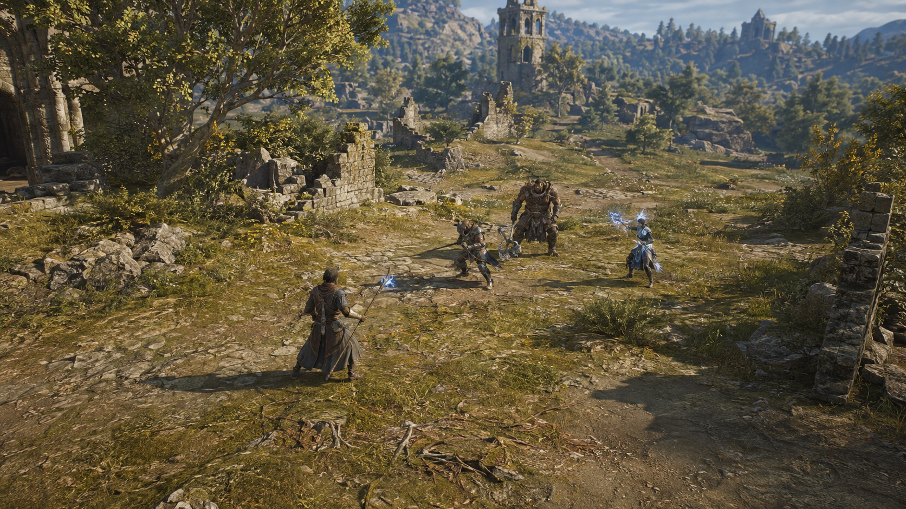
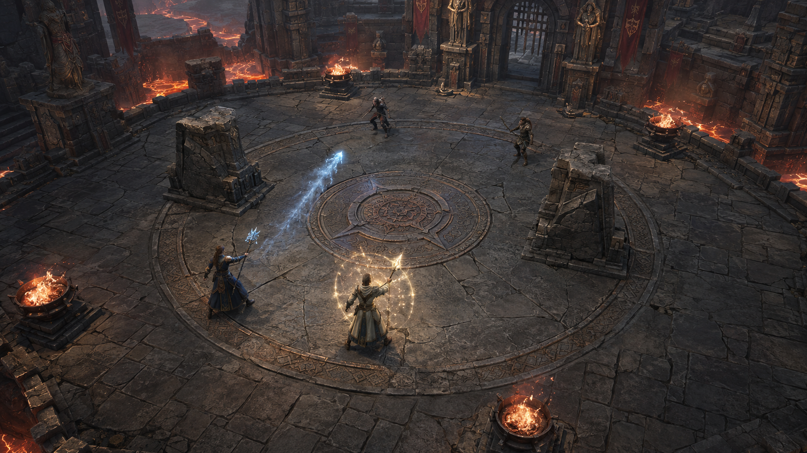
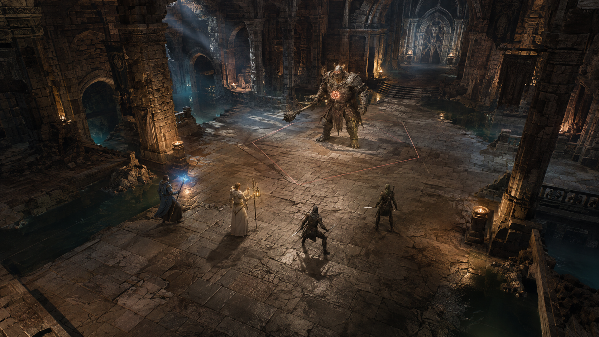

# Three-mode realism targets — 2026-09-07

These three original, AI-generated artworks are proposed visual targets, not game
screenshots, shipped assets, or accepted implementation. They share believable
human proportions, weathered materials, restrained spell effects and readable
combat space. There are deliberately no UI controls or quest markers in the art.
The separate [HUD resize evidence](../HUD_LARGE_CONTROLS_EVIDENCE.md) covers the
actual 1.3× mobile controls.

The user subsequently requested that the actual 3D game approach this direction.
See the [implementation sequence](REALISM_IMPLEMENTATION.md) for the first
Sunbreak benchmark and the remaining Arena, Dungeon and character work.

## Leveling — Sunbreak Basin

Persistent PvE mob grinding in a collection of regions. A sunlit valley and ruined
frontier settlement supply a sense of place, with broad approaches, natural
vegetation and irregular clearings instead of a single road. The pack has distinct
melee, ranged and elite silhouettes. This represents the newer PvE Leveling mode,
not the separate Ashen Causeway Training route.

## Arena — Rift Crucible

Compact tactical 2v2. The two wardstones, four braziers and dangerous outer lava
boundary stay easy to locate. A quiet fighting floor contrasts with the detailed
fortress perimeter; cool daylight and local firelight expose the stone texture
without burying the players in darkness.

## Dungeon — The Broken Sanctum

A spacious cooperative encounter room with side galleries, branching exits,
layered architecture and room to dodge. Four heroes face a weighty stone-and-iron
warden. Daylight through broken vaults and warm torch pools reveal the encounter
floor. It is moodier than Leveling; preserve floor and silhouette readability when
interpreting this target in-engine, especially on a phone.

## Production boundary

These images establish proposed mood, composition and material detail, not exact
runtime geometry or camera calibration. Their character models, architecture and
lighting have not been implemented by this artwork task. The Leveling composition
also shows more distant landscape than a fixed gameplay-camera acceptance frame.
Do not treat its visible paths, the Dungeon telegraph or any generated prop as a
new collision or combat rule.

Review the direction with the user before another environment production pass.
Then build one bounded in-engine benchmark and compare actual player captures at
16:9, 20:9 and 2.4:1, including the enlarged HUD. Mobile performance, physical-device
readability and gameplay occlusion require separate evidence; a concept render
cannot establish any of them. Preserve earlier targets for historical comparison.

## Generation record

- Method: built-in `image_gen`, three independent new-image generations; no input
  reference images, image edits, compositing or post-processing.
- Exact prompts: [prompts.json](VisualTargets/mode-targets-20260907/prompts.json).
- Saved outputs: three original PNGs, each 1672 × 941 pixels, in
  `Docs/Art/VisualTargets/mode-targets-20260907/`.
- Source filenames and SHA-256 checksums:
  [manifest.json](VisualTargets/mode-targets-20260907/manifest.json).
- Generation originals remain in the tool output directory. The project copies
  are documentation assets outside Unity's `Assets/`; no import or rebuild is
  required for these concept images.
