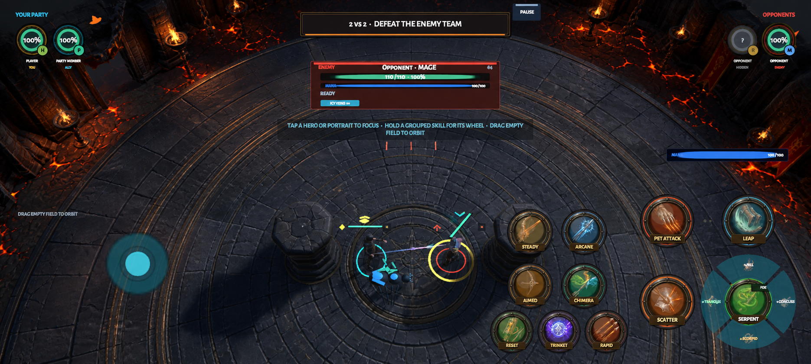

# Arena Visual Target

## Current three-mode proposal — 2026-09-07

See [Leveling, Arena and Dungeon realism targets](MODE_TARGETS_20260907.md) for the
new HUD-free original concept set. This proposal favors realistic proportions,
weathered materials and readable light across all three modes. It is not an
implemented art pass or user acceptance; the older Arena frames below remain
historical composition and comparison references.

## Reference frame

This environment-only image is a composition and finish target, not a shippable
screenshot and not a promise that generated concept pixels exist in-engine. It uses
the in-game screenshot as its layout reference and preserves the arena footprint,
wardstones, four-combatant read, joystick, and the then-current dense action grammar
so environment reviews could compare like with like. Its HUD is historical and is
not the current ten-control `2 + 4 + 4` target. The implemented Arena pass now uses a
target-oblique perspective at yaw `90`, pitch `40`, follow distance `18 m`, forward
focus offset `2.3 m`, right focus offset `0 m`, and field of view `46` degrees. The
prior whole-frame target remains available at
`VisualTargets/arena-quality-target-v1.png`.

The v2 image represents only the default Arena yaw of `90` degrees. Runtime Arena
orbit is intentionally bounded to `30..150` degrees (`90° ± 60°`), so environment
acceptance also requires captures at both endpoints. Full `360`-degree orbit is
deferred until the complete circumference has authored occlusion, silhouette, and
mobile-budget proof.

The desired bar is a mature stylized fantasy MMORPG rendered for a mobile strategy
camera. Art must remain original. Do not reproduce Warcraft characters, armor,
icons, UI frames, symbols, environments, sounds, or spell effects.

### PvE basin direction — 2026-09-04

The user rejected Sunbreak Basin's toy-like graphics after its open-layout pass.
For this location, favor weathered naturalistic fantasy: small individual leaves,
tapered branching trunks, eroded rock profiles, credible masonry proportions and
fine organic ground texture. Avoid closed polygon-ball canopies, flat round rock
plinths, saturated lime fields and oversized toy masonry. Retain daylight and clear
combat silhouettes; dark fog is not a substitute for material or model quality.
This changes the basin's art direction, not Core topology, the accepted control
layout or the separate Training route. See [natural-surface evidence](../PVE_NATURAL_ART_EVIDENCE.md).
It remains an in-engine art candidate pending user and physical-device acceptance.

The 2026-09-01 `v8` in-engine capture reached the target's broad oblique framing,
dark ring, lava, and four-brazier hierarchy, but the user explicitly rejected its
surface, light, shadow, and architectural quality. It is not an accepted target
match. The current source pass replaces the false height-derived normals, adds a
generation-3.1 macro-cavity floor mask, evaluates a CC0 scanned masonry PBR source,
deepens the fortress silhouette and outer crust, and adds layered fire/cinder
atmosphere. High is now the authored default: native render scale, 4x MSAA, HDR,
4096 main-light shadows, four per-pixel additional lights per object, ACES, and
restrained bloom/grading.

Current generated-runtime comparison frames are:

- `build/review/arena-high-v19-yaw90-2400x1080.png` — 20:9 default yaw;
- `build/review/arena-high-final-qhd-yaw90-3200x1440.png` — final QHD 20:9 default yaw;
- `build/review/arena-high-ultrawide-yaw30-2592x1080.png` — 2.4:1 minimum yaw; and
- `build/review/arena-high-ultrawide-yaw150-2592x1080.png` — 2.4:1 maximum yaw.

They prove the High-tier macOS player renders those pixels and angles; they do not
prove physical-smartphone fidelity, frame rate, thermals, touch comfort, the
missing 16:9 review, the complete aspect/yaw matrix, or explicit user acceptance.

## What must survive into the game

1. **Material depth:** broad hand-painted stone variation, bevel response, localized
   wear, and restrained emissive fissures replace flat-color geometry.
2. **Composition:** the combat floor stays visually quiet; the outer ring, ruins,
   braziers, lava, and abyss provide scale without suggesting playable collision.
   The reference's view-facing banners and chains are finish cues, not current
   runtime requirements; they remain omitted because earlier implementations
   clipped the gameplay frame.
3. **Character authority:** class silhouettes, weapons, cloth/armor breakup,
   grounded feet, anticipation, release, and hit response read before nameplates.
4. **Controlled effects:** every spell has one strong shape and timing signature;
   particles support the cast instead of obscuring characters or floor telegraphs.
5. **Quiet resting HUD:** primary actions remain readable, while target badges and
   full directional spell captions reveal contextually during interaction or when a
   tactical blocker matters.

## Honest asset boundary

The retained KayKit and Quaternius assets are valid CC0 prototype sources, but their
shared Ranger/Peasant bodies, generic animation library, low-poly atlas materials,
and limited outfit range cannot reach this final bar through lighting alone.

Poly Haven Stone Brick Wall 001 is also valid CC0 source and is now wired as a
`TECH_REVIEW` `RuinStone` runtime candidate with a deterministic mobile mask. It is
third-party scanned PBR data, not original Session RPG texture art. A higher-quality
source does not by itself solve stylization, repetition, architectural silhouette,
gameplay-camera coherence, or Android cost; production acceptance remains pending.

Before replacing every class, build one camera-tested production benchmark around
Mage or Priest:

- an original Humanoid character with a strong top-down silhouette;
- one or two skinned materials and mobile LODs;
- a 2K source atlas imported at 1K on Android;
- bespoke anticipation, loop, release, interrupt, defensive, hit, and death clips;
- three signature spells reviewed in an actual 2v2 frame.

Only expand that pipeline to Rogue and Hunter after the benchmark holds up at 16:9,
20:9, and 2.4:1 without exceeding the budgets in `DEMO_READINESS.md`.

## Acceptance comparison

A visual pass is not accepted from a beauty shot alone. Capture the same gameplay
state before and after with the target-oblique camera at the authored default yaw
and both bounded orbit endpoints, then confirm:

- no exposed primitive/debug geometry;
- the arena reads as constructed space rather than a flat diagram;
- teams, human, focus, cover, lava, and cast destination remain identifiable in
  under one second;
- resting UI does not cover the fight with repeated relation or flick text;
- desaturated spell families remain distinguishable;
- the warm-frame allocation, triangle, draw-call, overdraw, and 60 FPS device
  contracts remain measurable and bounded.
