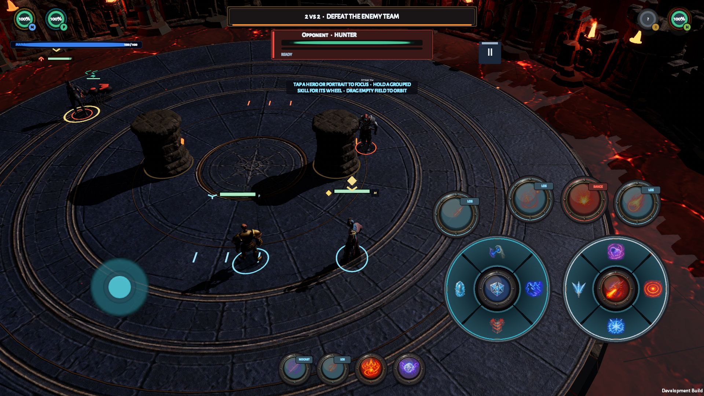
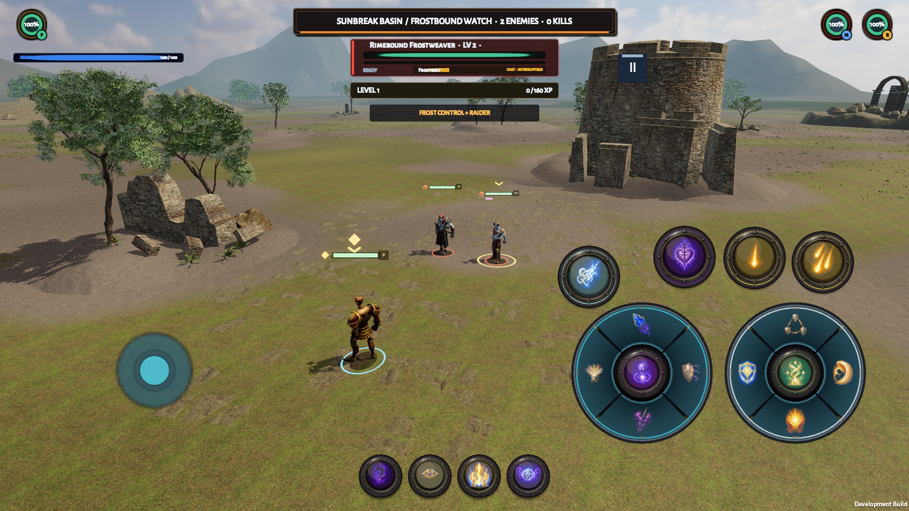

# Mobile MMORPG

A touch-first 3D fantasy combat RPG prototype built with Unity and C#. The goal
is immediate, readable action with deep class decisions: positioning, interrupts,
crowd control, defensive timing and coordinated play.

The current game runs **locally**, with bots where the mode requires teammates
or opponents. Online Arena and cooperative PvE are future work, not implemented
gameplay. Visuals, balance and sustained mobile performance are still in development.

## Arena

Local 2v2 combat with line-of-sight cover, explicit targeting, class abilities,
knockback and a hazardous lava perimeter.



## PvE Leveling

Explore Sunbreak Basin, fight repeatable mob camps and retain per-specialization
XP from level 1 to 10 on the device. Seven camps mix melee, ranged, caster,
support and elite enemies. No quests, equipment drops or online co-op yet.



Both images are unedited 1920×1080 macOS Development-build captures from
2026-09-08, not concept art or phone screenshots. They show a work-in-progress
build; see the [dated capture and verification record](Docs/PVE_GRAPHICS_AND_CREEP_FIX_EVIDENCE.md).
The captured local build uses licensed character bases that are **not included
in this public repository**. Public checkouts use the CC0 Quaternius fallback
characters, so their hero/enemy appearance differs from these historical images.

## What is here

| Mode | Current scope |
|---|---|
| Arena | One local 2v2 battleground: one human and three bots. |
| PvE Leveling | Solo, no-quest grinding in a streamed 3 × 3 region; seven repeatable camps and device-local progression. |
| Training | Skippable guided combat onboarding with a learned-action progression. |
| Dungeon | Local four-hero, four-floor prototype with bots and same-floor retry. |
| Hero Siege | Prototype fortress defense with solo/four-lane variants and overlapping waves; acceptance gaps are documented separately. |

Four classes offer seven specializations: Discipline/Shadow Priest, Fire/Frost
Mage, Shadow Dance/Mutilate Rogue and Marksmanship Hunter. Ten visible controls
expose up to eighteen actions using two tap-and-cardinal-flick gesture families.
The Unity-independent combat simulation runs deterministically at 30 Hz;
animation, physics and rendering do not decide combat outcomes.

The separate [C#/.NET server prototype](Server/README.md) provides local developer
identities, SQLite character/personal-world metadata and owner-plus-guest
admission. It is **not connected to Unity combat or its saved XP**. It has no
public deployment, matchmaking or production account service.

## Run the game

Requirements: Unity Hub with **Unity 6000.5.6f1**. Install Android Build Support
(SDK, NDK and OpenJDK) if building for a phone. This directory is the Unity
project root.

```sh
git clone https://github.com/np96/mobile-mmorpg.git
cd mobile-mmorpg
```

The public project includes its CC0 character fallback and regenerated playable
foundation. No Adobe account or licensed Mixamo download is needed to run it.

1. Open the repository in Unity Hub using the pinned Editor version.
2. Let the committed packages and assets finish importing.
3. Open `Assets/SessionRpg/Scenes/Bootstrap.unity` and press Play.
4. Select a class, specialization and mode, then enter combat.

Desktop controls: **WASD** to move, **Q/E** or an empty-world horizontal drag to
orbit, and **1–9 / 0** for the ten action controls. Hold **Shift** or **Ctrl** for
the configured Up or Right alternate on a gesture family. Click/tap a hero or
portrait to focus that exact unit. Touch controls remain visible and support
movement, selection and cardinal ability flicks.

The checked-in scene, prefabs and much of the art are generated from authoring
code. A normal checkout does not require a rebuild before opening; do not tune
generated assets in the Inspector. Read [AGENTS.md](AGENTS.md) and the
[agent workflow](Docs/AGENT_WORKFLOW.md) before changing the foundation.

## Development commands

Run from the repository root. The Unity wrapper currently locates Hub Editors on
macOS; `SESSION_RPG_UNITY_BIN` can select an explicit Editor executable.

Python 3 is required for NUnit XML validation and the public-source check; these
helpers use only the standard library. Ignored source-specific tests are reported
separately as not run, not counted as passes.

```sh
Tools/Agent/unity.sh doctor
Tools/Agent/unity.sh validate
Tools/Agent/unity.sh test-all
```

Use `Tools/Agent/unity.sh rebuild` only after an authoring or serialized-composition
change, with the Editor closed. Saved open-Editor work can be validated/tested
using `Tools/Agent/unity.sh --isolated validate` or `--isolated test-all`.
Build commands are `build-macos` and `build-android`; artifacts and per-run
logs are written outside the source project under `../outputs/`.

For the separate server, install the SDK pinned in `Server/global.json`
(currently **.NET 10.0.400**), then run:

```sh
Tools/Agent/server.sh doctor
Tools/Agent/server.sh restore --locked-mode
Tools/Agent/server.sh build
Tools/Agent/server.sh test
```

See [Server/README.md](Server/README.md) for provisioning and local API startup.
Do not commit its generated credentials or database, and do not expose its local
HTTP endpoint publicly.

## Project map and status

- [DESIGN.md](DESIGN.md): product rules, combat kits and scope.
- [ARCHITECTURE.md](ARCHITECTURE.md): implemented boundaries and target architecture.
- [Docs/DEMO_READINESS.md](Docs/DEMO_READINESS.md): current capability gaps and acceptance gates.
- [Docs/REPOSITORY_PUBLICATION.md](Docs/REPOSITORY_PUBLICATION.md): public-checkout preparation and dated verification.
- [Docs/PVE_LEVELING_MODE.md](Docs/PVE_LEVELING_MODE.md): grinding, persistence and region rules.
- [AGENTS.md](AGENTS.md): coding-agent contract, validation and handoff requirements.

Tests and builds must be rerun for the revision being evaluated; historical
evidence is not a current pass. Production-quality art, sustained High-quality
iQOO Neo11 profiling, long-session stability and networked gameplay remain open
gates. A successful desktop capture or Android package does not prove those gates.

## Source and asset rights

This is a **public development source repository**, not a blanket asset license
or asset pack. Original and derived Adobe Mixamo Content Files from the local
development build are excluded; the public character source is CC0 Quaternius.
Preserve all `.meta` files, provenance and [third-party notices](THIRD_PARTY_NOTICES.md).

See [public source distribution](Docs/PUBLIC_SOURCE_DISTRIBUTION.md) for excluded
paths, the four historical model names and official Adobe sources, and the
separate requirements for optional private character customization. Switching
a source constant alone does not acquire a license or produce a valid import.
Public availability does not grant an open-source license to the game's own
code or artwork; no such license has been selected.
